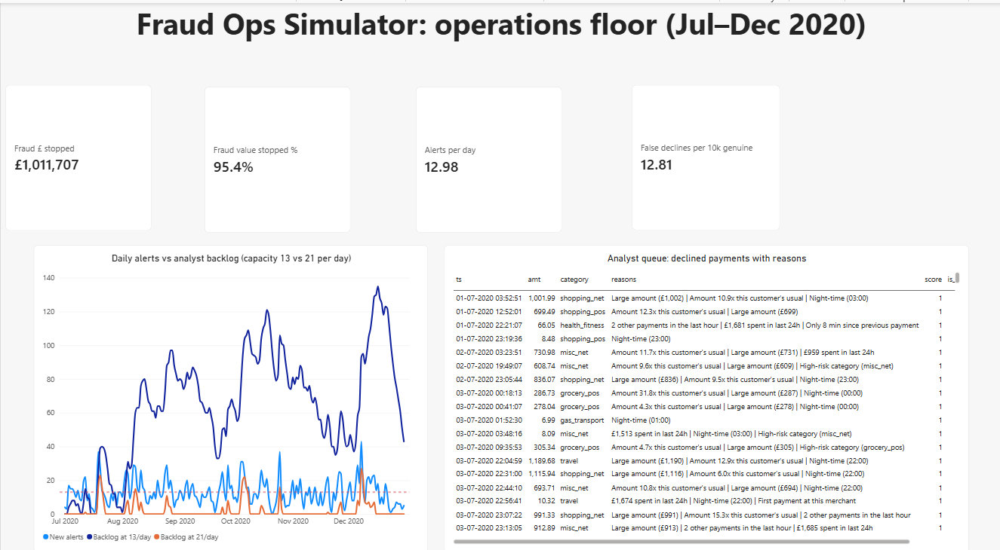
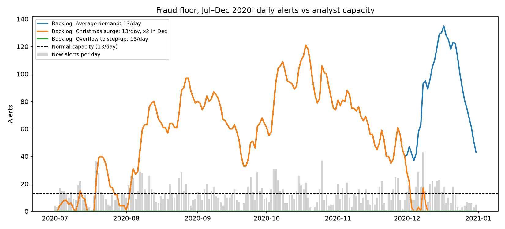
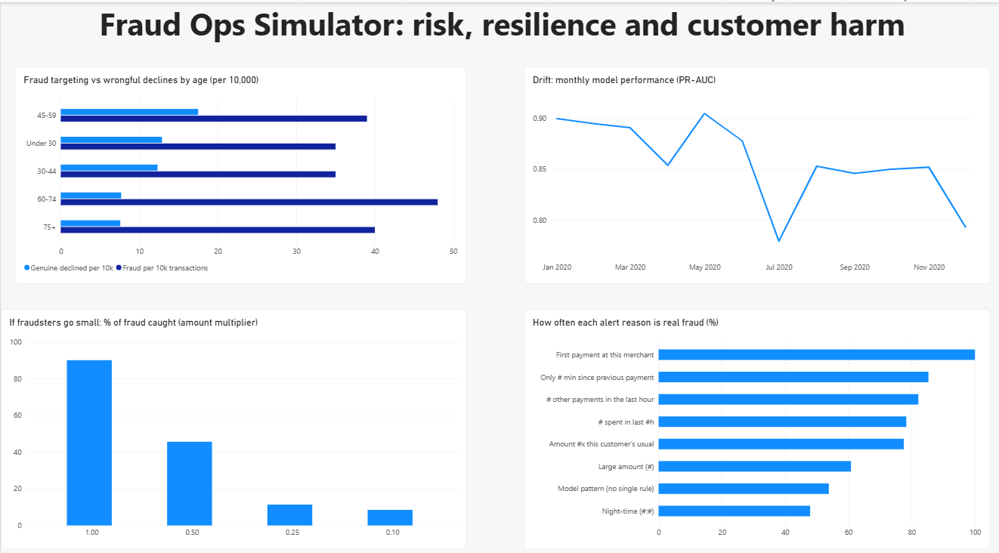

# Fraud Ops Simulator: judging a fraud model by what a fraud team actually needs

Most fraud projects stop at "AUC = 0.98". This one puts the model **inside a fraud operation**, with limited analysts, customers who hate being wrongly declined, fraudsters who adapt, and Consumer Duty expectations, and then asks which decisions minimise the total £ cost.

**Headline results (sealed test period, Jul–Dec 2020):**
- **95.4% of fraud value stopped** (£1,011,707 of £1,060,050), with **12.8 genuine payments wrongly declined per 10,000**.
- A **step-up tier** (one-time passcode for medium-risk payments) **cut wrongful declines by 63%** and total cost by 18% compared with decline-only, while stopping slightly *more* fraud.
- ⭐ **Staffing for the average day is the most expensive option.** With capacity equal to average alert volume, the backlog grew to 135 and blocked genuine customers waited ~5 days. The cheapest plan was **~1.5× average alert volume**, and that result held under every cost assumption tested.
- ⭐ **The model's weak spot:** if fraudsters halve their transaction amounts, fraud caught in the top 1% falls from **90% to 46%**. Velocity-based alert reasons (78–85% real fraud) are the defence that still works.
- **Retraining on newer data made the model worse** (PR-AUC 0.828 → 0.805), so retrained models need champion vs challenger testing before deployment.
- **Older customers are targeted more** (60–74s: 0.48% fraud rate vs 0.35% for under-45s), yet were protected well and **wrongly declined least**.



---

## 1. Data
- **Kaggle: "Credit Card Transactions Fraud Detection Dataset"** (Kartik Shenoy). **1,852,394 transactions**, Jan 2019 – Dec 2020, 999 cards, 693 merchants, **0.521% fraud**.
- ⚠️ **Synthetic data** (generated by the Sparkov simulator). Real transaction data is never public. Fraud patterns here are cleaner than in reality, so **model scores are likely optimistic**. Amounts are US dollars, and all £ figures are **illustrative**.
- No missing values and no duplicate transactions.

**Patterns found:**
- Fraud is **10–25× more likely between 10pm and 3am** (1.3–2.6% vs ~0.1%).
- Online shopping is riskiest (`shopping_net` 1.59%).
- **December volume doubles** (141,060 transactions in Dec 2019).

**Time-based split. No random split, so the model never sees the future:**

| Period | Months | Transactions | Fraud rate | Used for |
|---|---|---|---|---|
| Train | Jan–Dec 2019 | 924,850 | 0.564% | Fitting the model |
| Validation | Jan–Jun 2020 | 401,883 | 0.602% | Choosing the policy and cut-offs |
| **Test (sealed)** | **Jul–Dec 2020** | 525,661 | **0.383%** | Simulation, drift and fairness |

## 2. Behaviour features (past information only, no leakage)

| Feature | Genuine (median) | Fraud (median) |
|---|---|---|
| Amount | £47 | **£390** |
| Amount vs this customer's usual | 0.67× | **5.24×** |
| Spend in the last 24h | £183 | **£1,707** |
| Time since previous payment | 4.4 hours | **1.4 hours** |
| Distance from home | 78 km | 78 km (**no signal** in this simulated data, reported rather than hidden) |

Other features: transactions in the last 1h and 24h, new merchant or category for this customer, night-time, hour, category and age.

## 3. Model: and why ROC-AUC isn't enough
Gradient boosting (scikit-learn `HistGradientBoostingClassifier`) vs logistic regression, scored on validation:

| | Logistic regression | **Gradient boosting** |
|---|---|---|
| ROC-AUC | 0.965 | 0.975 |
| **PR-AUC** | 0.557 | **0.888** |
| Fraud caught, reviewing the top 1% | 70% | **92%** |
| Alerts that are real fraud (top 1%) | 42% | **55%** |

ROC-AUC made the two models look nearly the same; **PR-AUC**, the fair measure for rare events, showed a large gap.
**Diminishing returns:** reviewing the top 0.5% catches 77% of fraud with 92% of alerts being real; going from 1% to 2% doubles analyst workload for **+1.5 points** of fraud caught.

Top drivers (permutation importance): amount, fuel/transport category, 24h spend, amount vs usual, time since previous payment.

## 4. Decision policy: approve / step-up / decline, in £
Illustrative costs: analyst review **£3** per alert · false decline **£10** · passcode friction **£0.50** · a passcode stops **80%** of fraud attempts. Both cut-offs were optimised on **validation** data.

| Strategy (validation) | Cost per month | Fraud value stopped | Wrongful declines per 10k genuine | Alerts per day |
|---|---|---|---|---|
| No model | £214,399 | 0% | 0 | 0 |
| Decline only | £12,249 | 96.1% | 31.1 | 19.1 |
| **Step-up + decline** | **£10,020** | **96.4%** | **11.6** | **14.5** |

Chosen policy: **step-up if score ≥ 0.005, decline if score ≥ 0.10.** When a false decline is valued at £20 or more, the optimal decline cut-off rises to 0.15 and wrongful declines fall to 9.8 per 10k: the more customer harm is valued, the more cautious the policy becomes.

## 5. ⭐ Fraud floor simulation (sealed test months, day by day)
Declines become alerts. Analysts review a fixed number per day, riskiest first, and the rest wait. **A genuine customer's card stays blocked until reviewed** (priced at £5 per customer per day).

Test-period demand: **13.0 alerts per day on average, busiest day 43**.

| Staffing plan | Cost per month | Fraud stopped | Avg wait | Max backlog | Genuine customers blocked overnight |
|---|---|---|---|---|---|
| Lean (9/day) | £44,502 | 95.4% | 30.8 days | 787 | 589 |
| Average demand (13/day) | £16,881 | 95.4% | 4.9 days | 135 | 377 |
| **Generous (23/day)** | **£11,413** | 95.4% | **0.1 days** | 21 | 63 |
| Christmas surge (13/day, ×2 in Dec) | £15,248 | 95.4% | 3.8 days | 121 | 278 |
| Overflow to step-up (13/day) | £14,726 | **92.8%** | 0 | 0 | 0 |

- **Queueing effect:** staffing exactly at average demand lets busy days build a backlog that quiet days never clear.
- **The Christmas surge wasn't needed:** transactions doubled in December but alerts didn't (13.1/day), because the December fraud rate was low. **Staff to the alert forecast, not transaction volume.**
- **Overflow to step-up** eliminates waiting but lets ~£28k more fraud through over six months. It's a good emergency valve, not a standing plan.

**Staffing sweep (robustness check):** the cheapest capacity was **21 alerts/day** at £5 or £10 per day of customer harm (15/day at £1). The cost curve is **flat between ~17 and 25/day**, so the recommendation of **~1.5× average alert volume** is robust.



## 6. Drift, retraining and fraudster adaptation
- **Drift:** monthly PR-AUC fell from ~0.90 (Q1 2020) to 0.78–0.85 (H2). The dips line up with **low-fraud months** (July 0.37%, December 0.19%), and PR-AUC falls when fraud gets rarer. Fraud caught in the top 1% stayed at **86–94% every month**, so the ranking held.
- **Champion vs challenger:** a model retrained on 2019 + H1 2020 scored **lower** on Jul–Dec (PR-AUC 0.805 vs 0.828; fraud caught 87.8% vs 90.1%). **Never auto-deploy a retrained model.**
- **Fraudsters go small** (fraud amounts and amount-based features shrunk on the test set):

| Fraud amounts × | 1.0 | 0.5 | 0.25 | 0.1 |
|---|---|---|---|---|
| Fraud caught (top 1%) | **90.1%** | **45.6%** | 11.4% | 8.5% |

The model leans heavily on amount. **Recommendations:** add amount-independent signals (merchant risk, device and location change), add cumulative-velocity rules, and monitor the share of small-value fraud. *(This scenario is pessimistic: real "going small" would also create more transactions, which the velocity features would partly catch.)*

## 7. Alert explanations for analysts
Each flagged payment gets up to 3 plain-English reasons, ranked by how rare the value is among genuine 2019 transactions. For example: *"£5,614 spent in last 24h | Large amount (£907) | Amount 11.6x this customer's usual"*. That card made four payments in one day, a classic cash-out burst.

| Top reason on the alert | Alerts | Real fraud |
|---|---|---|
| Only minutes since previous payment | 34 | **85.3%** |
| Several payments in the last hour | 162 | **82.1%** |
| Large spend in last 24h | 920 | 78.3% |
| Amount × customer's usual | 476 | 77.5% |
| Large amount alone | 640 | 60.8% |
| Night-time alone | 140 | **47.9%** |

**Velocity reasons are the most reliable, and they're also the signals that survive fraudsters going small.** ("First payment at this merchant" showed 100%, but that's from only 4 alerts, so it's not reliable.)

## 8. Customer harm by age (Consumer Duty)

| Age | Fraud rate | Fraud caught | Genuine declined per 10k | Genuine asked for passcode per 10k |
|---|---|---|---|---|
| Under 30 | 0.35% | 93.5% | 12.9 | 79.8 |
| 30–44 | 0.35% | 87.7% | 12.3 | 71.6 |
| 45–59 | 0.39% | 90.0% | **17.5** | 66.0 |
| **60–74** | **0.48%** | 91.7% | 7.7 | 58.5 |
| 75+ | 0.40% | 93.3% | 7.6 | 54.1 |

Older customers are **targeted more** but are **protected well** and **inconvenienced least**. Recommendation: offer an **alternative to one-time passcodes** (e.g. a phone call) for customers with low digital confidence, because a passcode can itself be a barrier.



---

## Repository structure
```
01_explore.ipynb          data checks, fraud by hour / category / month
02_features.ipynb         behaviour features (past-only), time split
03_model.ipynb            logistic vs gradient boosting, PR-AUC, capacity metrics, importance
04_decisions.ipynb        approve / step-up / decline cut-offs optimised in £, sensitivity
05_simulation.ipynb       day-by-day fraud floor, staffing plans, staffing sweep
06_drift_fairness.ipynb   drift, champion vs challenger, fraudsters going small, harm by age
07_alert_reasons.ipynb    plain-English alert reasons, dashboard tables
fraud_ops_dashboard.pbix  Power BI: operations floor + risk & customer harm
outputs/                  charts and result tables
```
**To reproduce:** download the Kaggle dataset into `data/raw/` and run the notebooks in order (the data folder isn't committed because of its size).
**Tools:** Python (pandas, NumPy, scikit-learn, matplotlib), Power BI (DAX).

## Limitations
- **Synthetic data:** the patterns are cleaner than real fraud, so performance is optimistic, and some features (e.g. distance) carry no signal here.
- All £ costs (review, false decline, passcode friction, waiting) are **illustrative assumptions**, with sensitivity tested for the two that drive the decisions.
- The simulation treats capacity as alerts per day, with priority by score. It doesn't model shifts, fraud on cards still in the queue, or chargebacks.
- The fraudster adaptation test is a stress scenario, not a model of real criminal behaviour.
- The fairness check covers age only, because no other protected characteristics are present.

## What I'd do with real bank data
- Add device, IP, merchant-risk and payee data, and test amount-independent features against "small-value" fraud.
- Calibrate £ costs with the fraud, finance and complaints teams, including the real customer impact of false declines.
- Run champion vs challenger monitoring monthly, with an automated alert when the small-value fraud share rises.
- Feed the staffing model with **forecast alert volumes** (not transaction volumes), with an overflow-to-step-up rule for spikes.
- Offer accessible step-up alternatives for vulnerable customers, and track outcomes by age and vulnerability over time.
